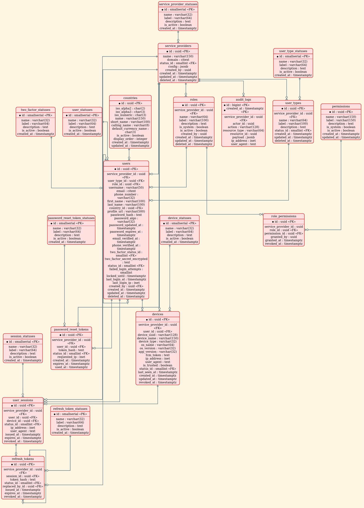

# user-service

The identity and access-control backbone of **OpenFinCore**: the one place where every tenant, user, role, permission, device, session, and auth event in the platform is defined, verified, and recorded.

Every product OpenFinCore ships — payments, wallets, partner integrations, reporting, whatever comes next — ultimately answers the same three questions: *who is this, what are they allowed to do, and can we prove it afterward.* `user-service` exists so that every other service in the platform can ask those three questions once, get the same answer every time, and never have to solve identity, authorization, or audit on its own.

## Why this service exists

OpenFinCore is a multi-tenant platform: many independent service providers — banks, PSPs, fintech operators, whoever onboards next — share one deployment. Left unmanaged, that creates four recurring failure modes across a growing set of services:

- **Tenant data bleeds together.** Without one authoritative boundary, it's a matter of time before a bug, a missing `WHERE` clause, or a copy-pasted query lets one tenant see or touch another's users, roles, or sessions.
- **"What permission is this?" stops having one answer.** If every service defines its own notion of permissions, the same numeric ID quietly means different things in different places, and authorization becomes a game of chance.
- **"Who did this, and when?" becomes unanswerable.** Without a durable, tamper-evident record of who acted and what changed, incident response, disputes, and compliance requests all become guesswork.
- **Every team re-solves the same problem, slightly differently.** Password hashing, session/refresh-token lifecycles, device trust, lockouts — each get reinvented per service, each with their own bugs.

`user-service` is where the platform solves each of these once, centrally, so that solving them again is never on any other team's plate.

## What it achieves

- **A single source of truth for identity and access.** One tenant, one user, one role, one permission grant — defined in exactly one place, referenced everywhere else. No service has to maintain its own shadow copy of "who is allowed to do what."
- **Tenant isolation as a guarantee, not a convention.** Multi-tenancy is enforced structurally, not just by application discipline — a tenant's data cannot be attached to another tenant's, and cannot be seen across the boundary, regardless of which application code touches it.
- **Permissions that mean the same thing everywhere.** Authorization decisions are federated from one shared, versioned catalog, so a permission checked in one service is guaranteed to mean the same thing when checked in another — now and after either service changes independently.
- **A permanent, append-only record of what happened.** Every sensitive action leaves an audit trail that is never edited or deleted, built to scale indefinitely rather than get pruned once it becomes inconvenient.
- **A complete authentication lifecycle, handled once.** Passwords, two-factor enrollment, trusted devices, sessions, refresh-token rotation, and password recovery are modeled as first-class, independently-auditable concerns — not afterthoughts bolted onto a `users` table.
- **A foundation other services can trust without re-verifying.** Because tenancy, authorization, and audit are guaranteed at this layer, every service built on top of it inherits those guarantees instead of having to re-implement or double-check them.

## The domain this service owns

*(Full schema: [`docs/user_service_schema.sql`](docs/user_service_schema.sql).)*

Four responsibilities, each with its own dedicated part of the model:

| Responsibility | What it covers |
|---|---|
| **Tenancy** | Every service provider onboarded onto the platform, and the status of its relationship with OpenFinCore. |
| **Access control (RBAC)** | Roles — global or tenant-specific — and the permissions granted to them, sourced from the platform's shared permission catalog. |
| **Identity & authentication** | Users, their verified contact details, password and two-factor state, trusted devices, active sessions, and the token lifecycles (refresh, password reset) that keep authentication secure without friction. |
| **Audit** | An immutable, permanently-retained record of who did what, when, and from where — built to outlive any single incident it might one day be needed for. |

This model is the platform's contract for identity: any service that needs to know who a user is, what tenant they belong to, or what they're allowed to do, asks this service — it never re-derives that knowledge itself.

## Where this is headed

The data and access-control foundation comes first, deliberately, before a single API endpoint. The ambition is for every future capability — login, admin consoles, permission management, cross-service authorization, compliance reporting — to be built *on top of* a foundation that is already correct, already tenant-safe, and already auditable, rather than discovering those requirements after the fact. As OpenFinCore grows to more services and more tenants, this is the layer everything else is meant to depend on without a second thought.
