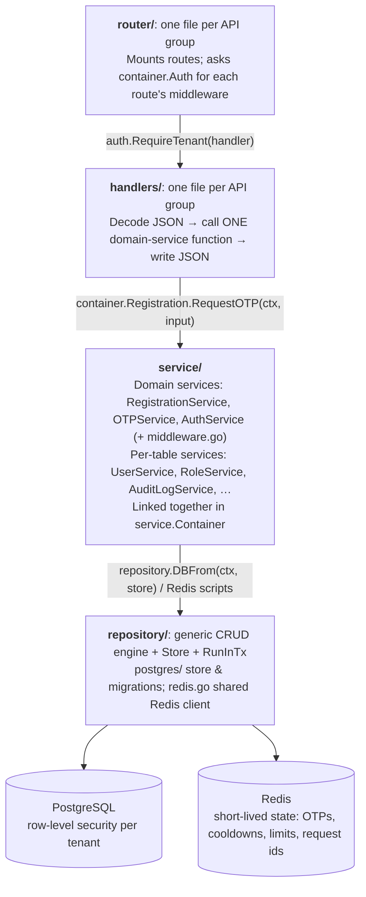
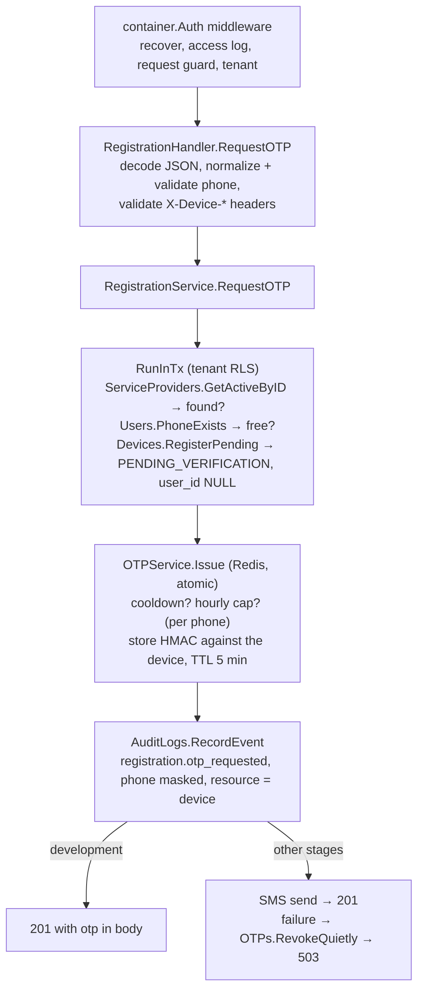

# user-service — Architecture & Development Guide

_As of 2026-10-21_

This guide sets out the rules every change to `user-service` follows. Its job is to keep the codebase scalable, readable and maintainable as more APIs are added (registration, login, refresh, password reset, 2FA, admin). Section 1 describes the architecture. Sections 2–9 give the rules for each part of the code. Section 10 gives step-by-step recipes, and section 11 walks through the registration OTP endpoint as an example.

Words used in this guide:

- **MUST / MUST NOT**: a hard rule. A PR that breaks one is not merged.
- **SHOULD**: the default. If you deviate, explain why in the PR.
- **Per-table service**: a type in `service/` that wraps exactly one table (`UserService`, `RoleService`, …).
- **Domain service**: a type in `service/` that owns no table and implements one business area (`RegistrationService`, `OTPService`, `AuthService`). Domain services are the only code that combines several per-table services.
- **Container**: `service.Container` (`service/container.go`), which builds every service and links them together.

> **Structure and schema are owner decisions.** **MUST NOT** add a new top-level folder/package or change the database schema (models, migrations, `docs/user_service_schema.sql`, seeds) without the codebase owner's explicit approval.

---

## 1. Architecture

### 1.1 Layers



A request moves through the diagram top down:

1. `router/` matched the route and `container.Auth` ran its middleware: panic recovery, an access log line, the global request guard (mandatory `X-Request-ID` + `X-Timestamp`, duplicate rejection) and, where required, the tenant.
2. The handler in `handlers/` decodes the body and calls one function on a domain service.
3. The domain service combines per-table services (and Redis-backed services) under one `c.Context`. Database work runs inside `RunInTx`.

`main.go` builds everything once at startup: `service.NewServiceContainer()`, then `router.New(container)`, then the HTTP server.

### 1.2 The dependency rule

- **MUST:** imports only point down: `main → router → handlers → service → repository → models, context, conf, logger`.
- **MUST NOT:** a lower layer imports a higher one. For example, `service` must not import `handlers` or `router`, and `handlers` must not import `repository` or GORM.
- **MUST:** only `service.Container` constructs services and links them. `router.New` receives the container and builds handlers from its services.

Following this rule has three payoffs:

- You can add another entry point (gRPC, a queue consumer) that calls the same domain services.
- You can unit-test domain services without HTTP and without a database.
- You can add a table without changes rippling upward.

### 1.3 What each layer may know

| Layer | Knows about | Must NOT know about |
| --- | --- | --- |
| `router/` | Paths, HTTP methods, which middleware each route needs (via `AuthService`) | Request bodies, business rules |
| `handlers/` | HTTP, JSON DTOs from `models/`, headers, status codes, domain-service input/result types | GORM, SQL, Redis, tables, transactions |
| `service/` domain services | Business rules, which tables to touch, transaction boundaries, `AppError` | JSON tags, routes |
| `service/` per-table services | Exactly one table and its common queries | Other tables' rules, transactions, HTTP |
| `repository/` | GORM, SQL, Redis connection, transaction plumbing | The business meaning of any column |

---

## 2. Project layout — where code goes

```
user-service/
├── main.go                         # container + router + HTTP server with graceful shutdown; nothing else
├── router/                         # one file per API group
│   ├── router.go                   # New(container): /healthz + every group behind container.Auth.Common
│   └── <group>_routes.go           # register<Group>Routes(mux, auth, handler)
├── handlers/                       # one file per API group
│   └── <group>_handler.go          # <Group>Handler: thin handler methods
├── service/
│   ├── container.go                # builds and links every service
│   ├── <table>_service.go          # one per-table service per file, e.g. service_provider_service.go
│   ├── <domain>_service.go         # domain services, e.g. registration_service.go, otp_service.go
│   ├── dev_tenant_service.go       # development only: ensures the dev tenant exists
│   ├── auth_service.go             # AuthService: exposes middleware to the router
│   ├── middleware.go               # middleware logic (request guard, access log, recover, tenant)
│   ├── http_response.go            # response envelope: WriteSuccess / WriteError / DecodeJSON
│   └── sms_service.go              # SMSSender interface
├── repository/
│   ├── query.go                    # generic CRUD engine
│   ├── store.go                    # Store interface, DBFrom
│   ├── tx.go                       # RunInTx
│   ├── redis.go                    # SharedRedis client
│   └── postgres/                   # Postgres Store, migrations, RLS SQL
├── models/                         # one GORM struct per table, status name constants,
│   ├── errors.go                   #   response-code catalog + AppError
│   └── <area>.go                   #   request/response DTOs + input validation, e.g. otp.go
├── conf/                           # config structs + config.json
├── context/                        # c.Context (tx, tenant, actor, request id)
├── logger/                         # zap-based logging helpers
└── seeds/                          # JSON seed data for lookup tables
```

| You are adding… | It goes in |
| --- | --- |
| A query on one table ("find user by phone") | A method on that table's service in `service/` |
| A business operation touching one or more tables | A function on a domain service, `service/<domain>_service.go` |
| A new business area | A new `service/<domain>_service.go` + one line in `container.go` |
| Short-lived state (codes, cooldowns, counters) | Redis, through a domain service (see `OTPService`) |
| An HTTP endpoint | A method in `handlers/<group>_handler.go` + one line in `router/<group>_routes.go` |
| A new API group | `handlers/<group>_handler.go` + `router/<group>_routes.go` + one call in `router/router.go` |
| New middleware | Logic in `service/middleware.go`, exposed as an `AuthService` method |
| A new error / response code | One catalog entry in `models/errors.go` (next free number in its range) |
| A new table, column or seed | **Ask the owner first** (see the note at the top) |

---

## 3. Layer rules

### 3.1 router/

- **MUST** put each API group in its own file `router/<group>_routes.go` with one `register<Group>Routes(mux, auth, handler)` function. `router.New` calls each one.
- **MUST** attach middleware only through `container.Auth` (`auth.RequireTenant(...)`, later `auth.RequireUser(...)`). **MUST NOT** call middleware functions from `service/middleware.go` directly.
- **MUST** mount every API under `/v1/` and use Go method patterns (`"POST /v1/users/register/request"`).
- **MUST** register API groups inside `newAPI`, which wraps them in `auth.Common` (the global middleware) and answers unknown routes with `auth.NotFound()` (code 1010). Only operational endpoints such as `GET /healthz` live outside it, in `router.New`.
- **MUST NOT** contain handler logic. A route line names a handler method and its middleware, nothing else.

```go
func registerRegistrationRoutes(mux *http.ServeMux, auth *service.AuthService, h *handlers.RegistrationHandler) {
    mux.Handle("POST /v1/users/register/request", auth.RequireTenant(http.HandlerFunc(h.RequestOTP)))
}
```

### 3.2 handlers/

- **MUST** put each API group's handlers in `handlers/<group>_handler.go`, on one `<Group>Handler` struct.
- **MUST** depend on a small, unexported interface of the domain service it calls, not on the concrete type. Tests then pass a fake.
- **MUST** keep handlers thin:
  1. Decode into the request DTO with `service.DecodeJSON`.
  2. Normalize and validate it with the DTO's own method, for example `utils.NormalizePhone` then `req.ValidatePhone()`.
  3. Call one domain-service function with `service.AppContext(r)`.
  4. Write the response DTO with `service.WriteSuccess(w, status, data)`, or `service.WriteError` on error.

  Aim for about 30 lines, with no business `if`s.
- **MUST** define request/response DTOs (with JSON tags) and their validation in `models/<area>.go`, for example `models.RequestOTPRequest` in `models/otp.go`. **MUST NOT** serialize GORM models directly.
- **MUST** send `Cache-Control: no-store` on responses that carry secrets or one-time values.

### 3.3 service/ — per-table services

- **MUST** define one named type per table, embedding the generic engine: `type UserService struct{ *CRUDService[models.User] }`. Status tables embed `*StatusLookup[T]` instead.
- **MUST** put each per-table service in its own file, `service/<table>_service.go`, for example `role_service.go` or `country_service.go`.
- **MUST** touch only its own table. Preloading children is fine; writing to another table is not.
- **MUST** own every operation on its table that more than one caller needs, such as "get the ACTIVE tenant" or "write an audit event". Other services call that method instead of re-implementing it (see section 3.7).
- **MAY** call another service it is linked to in `service/container.go`. For example, `ServiceProviderService` uses `ServiceProviderStatusService.IDByName` to resolve ACTIVE.
- **MUST NOT** hand-write `BeginTx`/`CommitTx`/`Rollback`. A method that must also work on its own wraps its write in `repository.RunInTx`, which joins the caller's transaction when there is one. `AuditLogService.Record` does this so RLS applies.
- **MUST NOT** contain business rules such as "may this phone register?". Those belong in domain services.
- **MUST** return `(nil, nil)` for not-found. The caller decides whether that's an error.
- **SHOULD** name methods by meaning: `PhoneExists`, `GetByID`, `IDByName`. `GetBy…` returns one row, `ListBy…` many, `…Exists` a bool.

```go
func (s *UserService) PhoneExists(ctx c.Context, spID uuid.UUID, phone string) (bool, error) {
    return s.Exists(ctx, repository.QueryOptions{Filters: []repository.Filter{
        repository.Eq("service_provider_id", spID),
        repository.Eq("phone_number", phone),
    }})
}
```

### 3.4 service/ — domain services

- **MUST** put each business area in one file, `service/<domain>_service.go`, with one `<Domain>Service` type, built and linked in `service/container.go`.
- **MUST** hold its collaborators as small, unexported interfaces (fields). The constructor takes the concrete services from the container; tests build the struct with fakes.
- **MUST** own the transaction: wrap database work in `repository.RunInTx`. **MUST NOT** hand-write `BeginTx`/`CommitTx`/`Rollback`.
- **MUST** use plain input/result structs (`RequestOTPInput`, `RequestOTPResult`) with no JSON tags.
- **MUST** return `models.NewAppError(models.Code…)` (`models/errors.go`) for anything the caller should see. **MUST NOT** know HTTP status codes.
- **MUST** keep slow or external work (SMS, other services, password hashing) outside database transactions.
- **MUST** follow this order in each operation:
  1. Do tenant-scoped reads and rules inside `RunInTx`.
  2. Make the state change.
  3. Write the audit row.
  4. Do external work.
  5. Return the result.

  Input arrives already normalized and validated by the handler.

  If a later step fails, undo earlier non-transactional state (for example, `OTPService.RevokeQuietly`).

```go
type RegistrationService struct {
    store            repository.Store
    serviceProviders registrationTenants // *ServiceProviderService: GetActiveByID
    users            registrationUsers   // *UserService: PhoneExists
    devices          registrationDevices // *DeviceService: RegisterPending
    otps             registrationOTPs    // *OTPService: Issue, RevokeQuietly
    auditLogs        registrationAudit   // *AuditLogService: RecordEvent
    sms              SMSSender
    devMode          bool
}
```

### 3.5 service/ — middleware and AuthService

- **MUST** write middleware logic as unexported functions in `service/middleware.go`.
- **MUST** expose middleware to the router only through `AuthService` methods: `Common` (global), `RequireTenant`, `NotFound`, and later `RequireUser`.
- **MUST** build the request's `c.Context` in middleware, once per request:
  - the request guard sets `WithSession(<X-Request-ID>)`;
  - the tenant sets `WithServiceProviderID(id)`;
  - future authentication sets `WithActorID(id)` and checks permissions.

  Handlers read it with `service.AppContext(r)`.
- **MUST** recover panics and map errors in one place (`service.WriteError`). Unknown errors become code 5000 plus a log line. **MUST NOT** send internal error text to clients.
- **MUST NOT** trust `X-Forwarded-For` unless a trusted proxy is configured. `ClientIP` uses the TCP peer address.

**Global request guard (`AuthService.Common`)**: every API request must carry two headers.

| Header | Format | Purpose |
| --- | --- | --- |
| `X-Request-ID` | 1–64 chars of `A-Z a-z 0-9 . _ -` | Tracing: echoed on the response and used as the log session id |
| `X-Timestamp` | Unix time in seconds | Replay protection |

- The timestamp must be within ±`request.replayWindowSeconds` (default 300) of server time, otherwise the response is 1006.
- The pair (request id, timestamp) is claimed in Redis with `SET NX` under `reqguard:{<request-id>}:<timestamp>`, with a TTL of 2 × the window. A second request with the same pair while it's claimed is rejected with 409, code 1007, and never reaches a handler.
- A pair can't be replayed after its key expires, because by then its timestamp is outside the window.
- If Redis is unreachable the guard fails closed: 503, code 5001.

### 3.6 Container

- **MUST** be the only place that constructs services: per-table services first, then domain services linked to them.
- **MUST** pass a service the other services it calls through its constructor. For example, `NewServiceProviderService(store, serviceProviderStatuses)`.
- **MUST NOT** contain business logic. Adding a service means adding one field and one constructor call.

### 3.7 Calling other services

Every operation has exactly one owner, and everyone else calls the owner's method. When a domain service needs work that belongs to another table or domain, it calls that service's method. It never rebuilds the logic itself, so the same function runs in every flow that needs it.

| Need | Call | Don't |
| --- | --- | --- |
| Tenant exists and is ACTIVE | `ServiceProviderService.GetActiveByID` | Load the row and compare `StatusID` yourself |
| Create an ACTIVE tenant | `ServiceProviderService.CreateActive` | Resolve the status id and call `Create` yourself |
| Write an audit row | `AuditLogService.RecordEvent(ctx, AuditEvent{…})` | Marshal the payload, parse the IP or build `models.AuditLog` yourself |
| Register a sign-up device (PENDING_VERIFICATION, no user yet) | `DeviceService.RegisterPending` | Resolve the status id or insert `devices` yourself |
| Issue or undo an OTP (held against a device) | `OTPService.Issue`, `OTPService.RevokeQuietly` | Touch `otp:*` keys or log revoke errors yourself |
| Phone already taken | `UserService.PhoneExists` | Query `users` directly |

- **MUST** add a method to the owning service when the operation you need doesn't exist yet, then call it. **MUST NOT** add a private helper in the calling service.
- **MUST** declare only the owner methods you use in the caller's small dependency interface, for example `registrationAudit{ RecordEvent }`.

---

## 4. Context and transactions

- **MUST** pass `c.Context` (from `ofc-user-service/context`, imported as `c`) as the first argument of every service method.
- **MUST** use the `ctx` you were given, including the one `RunInTx` hands to its callback. A new context drops the transaction and the tenant.
- **MUST** treat `c.Context` as immutable. The `With…` methods return copies.
- **MUST** open transactions only with `RunInTx`. It joins a transaction that's already open, and rolls back on error or panic.

```go
func RunInTx(ctx c.Context, store Store, fn func(ctx c.Context) error) (err error) {
    if ctx.Tx() != nil {
        return fn(ctx) // join the caller's tx
    }
    txCtx, err := store.BeginTx(ctx)
    if err != nil {
        return err
    }
    defer func() {
        if p := recover(); p != nil {
            _ = store.Rollback(txCtx)
            panic(p)
        }
    }()
    if err = fn(txCtx); err != nil {
        _ = store.Rollback(txCtx)
        return err
    }
    return store.CommitTx(txCtx)
}
```

---

## 5. Multi-tenancy

Every tenant-scoped table has an RLS policy keyed on `current_service_provider_id()`, which reads the setting `app.current_service_provider_id`.

- **MUST** run every read or write of a tenant-scoped table inside `RunInTx`, with `ServiceProviderID` on `ctx`. `BeginTx` applies it with `set_config('app.current_service_provider_id', <id>, true)`. That is `SET LOCAL`, so a pooled connection never carries one tenant into another request.
- **MUST** also filter by `service_provider_id` explicitly. RLS is the guarantee; the filter keeps the intent visible.
- **MUST** scope Redis keys by tenant too, for example `otp:{PURPOSE:<tenant>:<recipient>}:device:<device-id>:code`.
- **MUST** use a non-superuser database role outside local development. Superusers bypass RLS even with `FORCE`. `conf/config.json` connects as `postgres`, which is acceptable only locally.

---

## 6. Responses and errors

**Every** response, success or error, uses one envelope:

```json
{ "code": 0, "message": "Success", "data": { "device_id": "…", "expires_at": "…", "resend_after_seconds": 60 } }
{ "code": 1000, "message": "Service Provider Id Header is required", "data": null }
```

- **MUST** write responses only through `service.WriteSuccess` / `service.WriteError`.
- **MUST** define every failure as one entry in the response-code catalog in `models/errors.go`. An entry is a `ResponseCode{Code, Kind, Message}`, where the `Kind` decides the HTTP status. A code's number and meaning **MUST NOT** change once released; add a new code instead.
- **MUST** return errors as `NewAppError(Code…)`, optionally with `.WithRetryAfter(d)` (sent as `Retry-After`) or `.WithCause(err)` (logged, never returned).
- **MUST** wrap internal errors with context: `fmt.Errorf("registration: checking phone: %w", err)`. Any non-`AppError` becomes code 5000.
- **MUST NOT** use `panic` for request-time errors. Panics are acceptable only at startup: config, database or Redis connection, migration or seed failures.

| Range | Area | Kind → HTTP |
| --- | --- | --- |
| `0` | Success | 200 / 201 |
| `1000–1099` | Request & headers | VALIDATION → 400, CONFLICT → 409, NOT_FOUND → 404 |
| `1100–1199` | Input fields | VALIDATION → 400 |
| `2000–2099` | Registration | NOT_FOUND → 404, CONFLICT → 409, RATE_LIMITED → 429, UNAVAILABLE → 503 |
| `5000–5099` | Server | INTERNAL → 500, UNAVAILABLE → 503 |

| Code | HTTP | Message |
| --- | --- | --- |
| 0 | 200/201 | Success |
| 1000 | 400 | Service Provider Id Header is required |
| 1001 | 400 | Service Provider Id Header must be a valid UUID |
| 1002 | 400 | Request Id Header is required |
| 1003 | 400 | Request Id Header must be 1-64 characters of letters, digits, '.', '_' or '-' |
| 1004 | 400 | Timestamp Header is required |
| 1005 | 400 | Timestamp Header must be a Unix time in seconds |
| 1006 | 400 | Timestamp Header is outside the allowed time window |
| 1007 | 409 | Duplicate request: this Request Id and Timestamp were already used |
| 1008 | 400 | Request Body must be a valid JSON object with only the documented fields |
| 1009 | 400 | Request Body is too large |
| 1010 | 404 | Route not found |
| 1011 | 400 | Device Id Header is required |
| 1012 | 400 | Device Id Header must be at most 128 characters |
| 1013 | 400 | Device Type Header is required |
| 1014 | 400 | Device Type Header must be one of MOBILE_IOS, MOBILE_ANDROID, WEB, DESKTOP, API_CLIENT |
| 1015 | 400 | Device Name, OS Name, OS Version or App Version Header is too long |
| 1100 | 400 | Phone Number is required |
| 1101 | 400 | Phone Number must be in international format, e.g. +923001234567 |
| 2000 | 404 | Service Provider not found |
| 2001 | 409 | Phone Number is already registered |
| 2002 | 429 | Please wait before requesting another code |
| 2003 | 429 | Too many codes requested for this Phone Number, try again later |
| 2004 | 503 | Could not send the verification code, please try again later |
| 5000 | 500 | Internal server error |
| 5001 | 503 | Service temporarily unavailable, please try again later |

---

## 7. Data, models and Redis

- **MUST NOT** change the schema without owner approval (models, `migratedModels()`, `postMigrationSQL`, `docs/user_service_schema.sql`). When a change is approved:
  - define one file per table in `models/`, with explicit `gorm:"column:…"` tags and `TableName()`;
  - add migrations idempotently;
  - keep `docs/user_service_schema.sql` in sync.
- **MUST** use `snake_case` JSON tags, and mark secrets `json:"-"`: password hashes, token hashes, 2FA secrets, FCM tokens.
- **MUST NOT** hard-code status ids. Use name constants (`models.ServiceProviderStatusActive`) resolved through `StatusLookup[T].IDByName`, which caches results.
- **SHOULD** keep short-lived state (OTP codes, cooldowns, counters) in Redis rather than new tables.
- **MUST** follow these rules for Redis data (current key families: `otp:{…}` and `reqguard:{…}`):
  - Get the client from `repository.SharedRedis()`.
  - Give every key a time-to-live (TTL).
  - Group one entity's keys under one hash tag `{…}`.
  - Do check-and-set logic in a single Lua script so it is atomic across instances.

## 8. Seeds and permissions

- **MUST NOT** add or change seed files without owner approval (seeds are schema data).
- **MUST NOT** rename or delete a seeded status name that code references.
- **MUST** define permissions only in `github.com/OpenFinCore/permissions-package`. This service seeds them from there.

**Development tenant.** When `stage` is `development`, startup runs `DevTenantService.EnsureDevTenant` (`service/dev_tenant_service.go`) right after seeding:

- If no tenant with `devTenant.id` exists (soft-deleted ones included), it creates one named `devTenant.name` via `ServiceProviderService.CreateActive`. Otherwise it skips and changes nothing.
- The defaults are id `d0d0d0d0-0000-4000-8000-000000000001` and name `Development Tenant`, so local clients (Postman) can use a fixed `X-Service-Provider-ID`.
- **MUST NOT** run outside development. Real tenants are onboarded, never auto-created.

---

## 9. Security, logging and audit

**Secrets and one-time codes**

- **MUST** generate codes with `crypto/rand`.
- **MUST** store codes and tokens only as an HMAC-SHA256 under a server secret, bound to the purpose, tenant, recipient and device. A plain hash of a 6-digit code is brute-forced instantly.
- **MUST** return a plain OTP only when `stage` is `development` (`config.IsDevelopment()`). In any other stage it is delivered out of band (SMS).
- **MUST** load secrets from the environment outside development: `OFC_OTP_HASH_SECRET` and `OFC_REDIS_PASSWORD`. The service refuses to start without the OTP secret.
- **MUST NOT** log codes, passwords, hashes, tokens or secrets. Mask phone numbers in logs and audit payloads (`+92******4567`). Add secret field names to `logger.secretKeys`.

**Logging**

- **MUST** pass `ctx.Session()` (the request id) as the logger's `session` argument, so one request's lines can be traced together.

**Audit**

- **MUST** write one `audit_logs` row for every state-changing operation by calling `AuditLogService.RecordEvent`.
  - `RecordEvent` encodes the payload, parses the IP, trims the user agent and fills the tenant and actor from `ctx`.
  - It runs in `RunInTx`, joining the caller's transaction when there is one.
  - Payloads **MUST** mask personal data, for example `utils.MaskPhone`.
  - Action names follow `<area>.<event>`, for example `registration.otp_requested`.
  - **MUST NOT** update or delete audit rows. The table is append-only.

**Input**

- **MUST** normalize input before validating it: trim strings, strip phone formatting, convert a leading `00` to `+`, validate E.164.

---

## 10. Recipes

### Add an endpoint to an existing API group
1. Add the domain logic as a method on the domain service (`service/<domain>_service.go`), following the order in section 3.4.
2. Add the DTOs and their validation in `models/<area>.go`, and a thin handler method in `handlers/<group>_handler.go`.
3. Add one route line in `router/<group>_routes.go`, with middleware from `auth`.
4. Add tests:
   - the domain service with fakes, in `service/<domain>_service_test.go`;
   - the route through the real `AuthService`, in `router/<group>_routes_test.go`.

### Add a new API group / business area
1. Create `service/<domain>_service.go` with the service type, its small dependency interfaces and a constructor taking concrete services.
2. Add one field and one constructor call in `service/container.go`.
3. Create `handlers/<group>_handler.go` and `router/<group>_routes.go`. Call `register<Group>Routes` from `router/router.go`.

### Add middleware
1. Write the logic as an unexported function in `service/middleware.go`.
2. Expose it as an `AuthService` method.
3. Apply it in the router files that need it.

### Add a query on one table
- Add a method on that table's service, built from `QueryOptions` and the filter helpers.

### Reuse logic from another service
1. Find the service that owns the table or domain.
2. If it lacks the method, add it there, with a test.
3. Add the method to the caller's small dependency interface and call it.

---

## 11. Worked example: registration OTP request

`POST /v1/users/register/request` with headers `X-Request-ID`, `X-Timestamp` and `X-Service-Provider-ID`, the device headers below, and body `{"phone_number": "+923001234567"}`.

| Device header | Required | Limit |
| --- | --- | --- |
| `X-Device-ID` | yes | 128 chars (stored as `devices.device_uuid`) |
| `X-Device-Type` | yes | `MOBILE_IOS`, `MOBILE_ANDROID`, `WEB`, `DESKTOP`, `API_CLIENT` |
| `X-Device-Name` | no | 150 chars |
| `X-OS-Name` | no | 64 chars |
| `X-OS-Version`, `X-App-Version` | no | 32 chars each |

The request registers the caller's device as a `devices` row with status `PENDING_VERIFICATION` and `user_id` NULL (the user doesn't exist yet; OTP verification links it). A repeat request from the same tenant + device id reuses that pending row. The OTP is held in Redis against the device id, while the cooldown and hourly cap stay per phone so switching devices can't flood a number.

| File | Role |
| --- | --- |
| `router/registration_routes.go` | `auth.RequireTenant(http.HandlerFunc(h.RequestOTP))` |
| `handlers/registration_handler.go` | Decodes `models.RequestOTPRequest`, normalizes and validates the phone, reads `service.DeviceHeaders(r)` and validates them, calls `RegistrationService.RequestOTP`, returns 201 via `WriteSuccess` |
| `models/otp.go` | `RequestOTPRequest` (+ `ValidatePhone`) and `RequestOTPResponse` (incl. `device_id`) |
| `models/device.go` | `DeviceFilters` (+ `ValidateDevice`) for the device headers; `Device.NewDevice(statusID)` |
| `service/registration_service.go` | Calls each owning service in turn: `ServiceProviders.GetActiveByID`, `Users.PhoneExists` and `Devices.RegisterPending` (in `RunInTx`), `OTPs.Issue` against the device, `AuditLogs.RecordEvent`, then sends the SMS or, in development, returns the code |
| `service/devices.go` | `DeviceService.RegisterPending` (linked to `DeviceStatusService`) |
| `service/service_provider_service.go` | `ServiceProviderService.GetActiveByID` (linked to `ServiceProviderStatusService`) |
| `service/auth_services.go` | `AuditLogService.RecordEvent` / `Record` |
| `service/otp_service.go` | Generates the code and stores its HMAC in Redis. One Lua script enforces the 60 s cooldown and 5-per-hour cap; `RevokeQuietly` undoes an undelivered code |



| Outcome | HTTP | Code |
| --- | --- | --- |
| Code issued: `data` = `{device_id, expires_at, resend_after_seconds, otp?}` (`otp` only in development) | 201 | 0 |
| Missing/invalid request id or timestamp, timestamp outside window | 400 | 1002–1006 |
| Same request id + timestamp replayed | 409 | 1007 |
| Missing/invalid tenant header | 400 | 1000 / 1001 |
| Missing/invalid device headers | 400 | 1011–1015 |
| Bad body, missing/invalid phone | 400 | 1008 / 1009 / 1100 / 1101 |
| Unknown or inactive tenant | 404 | 2000 |
| Phone already registered | 409 | 2001 |
| Cooldown or hourly cap | 429 + `Retry-After` | 2002 / 2003 |
| SMS delivery failed | 503 | 2004 |

---

## 12. Testing standards

- **MUST** unit-test every domain service with fakes for its dependencies. Cover the success path, each validation failure, each `AppError` branch, and every undo path.
- **MUST** test Redis logic against `miniredis`, which runs the Lua scripts: TTLs, cooldown, caps, revoke and concurrency.
- **MUST** test middleware (`service/middleware_test.go`) against `miniredis`: every guard rejection, duplicates, and fail-closed behaviour.
- **MUST** test routes through the real `AuthService` middleware with a fake domain service. Check status codes, response codes, headers and the envelope shape. Test requests must send valid `X-Request-ID` / `X-Timestamp` headers.
- **SHOULD** integration-test with a real Postgres anything RLS- or constraint-sensitive, as a non-superuser role.
- **MUST** add every new response code to `catalog` in `service/errors_test.go` (the catalog itself lives in `models/errors.go`), which fails if two codes share a number or success is not 0.
- **MUST** pass `go build ./... && go vet ./... && go test ./...` before merging.

## 13. PR checklist

- [ ] No new top-level folder and no schema/seed change without owner approval
- [ ] Imports point down only (section 1.2); services are built and linked only in `service/container.go`
- [ ] Routes in `router/<group>_routes.go`, middleware only via `AuthService`; handlers thin, in `handlers/<group>_handler.go`
- [ ] Per-table services touch one table and never hand-write transactions
- [ ] Shared logic is a method on its owning service and callers call it; no copies in the caller (section 3.7)
- [ ] Domain service uses `RunInTx`, small dependency interfaces, and keeps external work outside transactions
- [ ] Tenant-scoped DB access runs with `ServiceProviderID` on ctx; Redis keys are tenant-scoped with TTLs
- [ ] Responses use the envelope; every failure is a catalog code (new codes added, none renumbered); no internal error text reaches clients
- [ ] No hard-coded status ids
- [ ] State-changing operations write one audit row
- [ ] No secrets or plain codes in logs or responses (except the development OTP)
- [ ] Tests added; build, vet and test pass

## 14. Status

Built:

- [x] `RunInTx`; `BeginTx` applies the tenant for RLS
- [x] `StatusLookup[T]` with cached `IDByName`; status name constants
- [x] Redis client (`repository/redis.go`); `OTPService` with atomic issue/revoke
- [x] Response envelope + numeric response-code catalog; `AppError`
- [x] `middleware.go` + `AuthService`; global request guard (mandatory `X-Request-ID` + `X-Timestamp`, Redis duplicate rejection)
- [x] `router/` + `handlers/`; HTTP server with graceful shutdown in `main.go`
- [x] `POST /v1/users/register/request`
- [x] Shared operations live on their owning services: `ServiceProviderService.GetActiveByID`/`CreateActive`, `AuditLogService.RecordEvent`, `OTPService.RevokeQuietly`
- [x] Development stage auto-creates the dev tenant on startup (skipped if it exists)

To do:

- [ ] A real `SMSSender` provider (non-development stages return 503 until one is wired)
- [ ] OTP verification endpoint (attempt counting is already stored per code)
- [ ] User authentication middleware (`AuthService.RequireUser`) and permission checks
- [ ] Trusted-proxy handling for client IPs behind a load balancer
- [ ] Rename `service/user-service.go` to `user_service.go`
